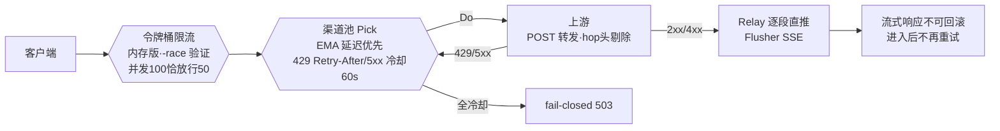

# agentgate-go

[agentgate](https://github.com/anlanjc/agentgate)（Python 版多租户 LLM 网关）**核心链路的 Go 重写**——双语言对照实验项目。

[](https://github.com/anlanjc/agentgate-go/actions/workflows/ci.yml) []() []() []() []()

## 架构总览



## 为什么重写

不是"Python 不行"，而是一个刻意设计的对照实验：同一个网关、同样的设计（令牌桶/EMA 故障转移/SSE 字节透传/优雅退出），分别用 asyncio 和 goroutine 实现一遍，把两种并发模型的真实差异压测出来。Python 版是完整叙事（多租户/记账/队列/管理面），本版只做核心请求链路。

## 四模块

| 模块 | Go 实现 | 对照点 |
|---|---|---|
| 限流 | 纯内存令牌桶（`sync.Mutex`，`-race` 验证并发 100 恰放行 50） | Python 版 = Redis+Lua 跨进程口径 |
| 负载均衡 | EMA 延迟优先 + 429 尊重 Retry-After / 5xx 冷却 60s | 语义逐条对齐 Python M2 |
| 流式转发 | `Do`/`Relay` 两段式（判定与转移在写响应前完成）+ `Flusher` 逐段直推 | Python 版 = 纯 ASGI 字节透传 |
| 退出 | `signal.NotifyContext` + `srv.Shutdown(10s)` 排空在途流 | Python 版 = uvicorn 信号处理 |

## 运行

```bash
# 零外部依赖，纯标准库
go build -o agentgate-go.exe .
UPSTREAM_1_URL=https://api.example.com UPSTREAM_1_KEY=sk-xxx ./agentgate-go.exe
curl -N localhost:8080/v1/chat/completions -d '{"model":"x","messages":[...]}'
```

## 测试

```bash
go test -race ./...   # -race 验证并发安全，必跑
```

## 对比结论

见 [docs/comparison.md](docs/comparison.md)（双语言同场景压测数据）。
