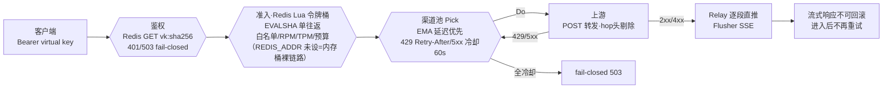

# agentgate-go

[agentgate](https://github.com/anlanjc/agentgate)（Python 版多租户 LLM 网关）**核心链路的 Go 重写**——双语言对照实验项目。

[](https://github.com/anlanjc/agentgate-go/actions/workflows/ci.yml) []() []() []() []()

## 架构总览



## 为什么重写

不是"Python 不行"，而是一个刻意设计的对照实验：同一个网关、同样的设计（鉴权/准入/令牌桶/EMA 故障转移/SSE 字节透传/优雅退出），分别用 asyncio 和 goroutine 实现一遍，把两种并发模型的真实差异压测出来。Python 版是完整叙事（多租户/记账/队列/管理面），本版做核心请求链路 + M1 鉴权/准入，记账写入/队列/管理面刻意不重写。

## 五模块（双口径）

| 模块 | Go 实现 | 对照点 |
|---|---|---|
| 鉴权 | virtual key：SHA-256(raw)→Redis GET `vk:{hash}`，JSON 档字段与 Python 版逐字对齐（跨语言交叉验证测试钉死）；无 DB 层，Redis 挂=fail-closed 503 | Python 版 = 缓存优先+PG 兜底+SETEX 60s 回填 |
| 准入限流 | Redis Lua 令牌桶（`rl:rpm:` 键，惰性补充），tpm/预算读合并进同一脚本，单次 EVALSHA；白名单→RPM→TPM→预算顺序同 Python | Python 版 admit.py = M1 单 Lua 调优产物 |
| 限流（裸链路口径） | 纯内存令牌桶（`sync.Mutex`，`-race` 验证并发 100 恰放行 50）——`REDIS_ADDR` 未设时启用 | Python 版无此口径（恒 Redis） |
| 负载均衡 | EMA 延迟优先 + 429 尊重 Retry-After / 5xx 冷却 60s | 语义逐条对齐 Python M2 |
| 流式转发 | `Do`/`Relay` 两段式（判定与转移在写响应前完成）+ `Flusher` 逐段直推 | Python 版 = 纯 ASGI 字节透传 |
| 退出 | `signal.NotifyContext` + `srv.Shutdown(10s)` 排空在途流 | Python 版 = uvicorn 信号处理 |

## 运行

```bash
# 裸链路口径：零外部依赖（内存令牌桶）
go build -o agentgate-go.exe .
UPSTREAM_1_URL=https://api.example.com UPSTREAM_1_KEY=sk-xxx ./agentgate-go.exe
curl -N localhost:8080/v1/chat/completions -d '{"model":"x","messages":[...]}'

# M1 同功能口径：Redis 鉴权 + Lua 准入（每请求 2 次往返）
UPSTREAM_1_URL=... UPSTREAM_1_KEY=... REDIS_ADDR=127.0.0.1:6379 ./agentgate-go.exe
# key 以 vk:{sha256(raw)} JSON 档预置进 Redis（字段名同 Python 版），请求带 Authorization: Bearer <raw>
# 完整基准流程（含预置 key/三目标对比）：scripts/compare_load_m1.sh
```

## 测试

```bash
go test -race ./...   # -race 验证并发安全，必跑；29 条（鉴权/准入/miniredis 内存 Redis，CI 无需 Redis 服务）
```

## 对比结论

见 [docs/comparison.md](docs/comparison.md)（双语言同场景压测数据：裸链路 0.3ms / M1 同功能口径 0.6~0.7ms，双口径并存 + Redis 故障语义对照表）。
